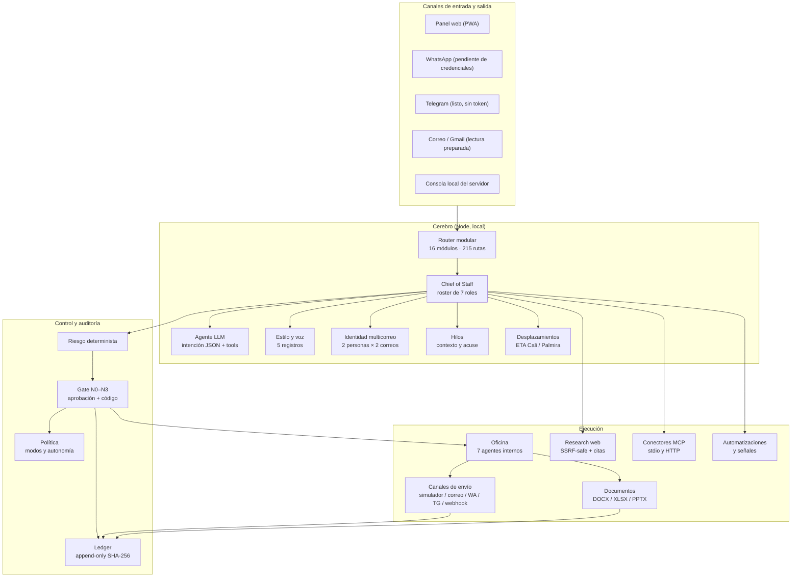
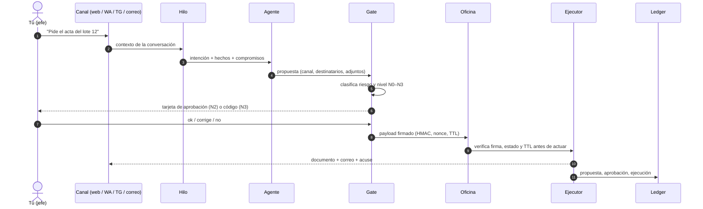

# Esquema de la oficina — Agenda Copilot P95

Documento vivo. Refleja **lo que está implementado**, no lo que se desea. Si una pieza no existe, aparece marcada como pendiente en [MAPA_CAPACIDADES.md](MAPA_CAPACIDADES.md).

---

## 1. Vista general: planos separados

**Regla dura:** nada sale hacia un tercero sin propuesta y aprobación. La autonomía es una excepción explícita (modo `total`/`autonomo` + `allowAutonomousOutbound` + riesgo ≤ 2 + contacto conocido + nunca N3) y queda en el ledger como `outbound.autonomous`.

---

## 2. Ciclo de una petición

---

## 3. Roles de la oficina

| Rol | Qué hace | Puede escribir fuera |
|---|---|---|
| `chief_of_staff` | Consolida, prioriza y es el único que te habla | No |
| `agenda` | Disponibilidad, conflictos, desplazamientos, Meet | No (propone) |
| `correspondencia` | Redacta, acusa y prepara envíos | Solo post-aprobación |
| `documentos` | Acta, Excel, PowerPoint, plantillas | No (genera) |
| `research` | Web con fuentes y citas | No |
| `qa` | Veto técnico: nombres, adjuntos, cifras, tono | No |
| `auditoria` | Solo lectura del ledger | No |

Ningún agente se aprueba a sí mismo: quien redacta no envía, quien envía no verifica.

---

## 4. Módulos técnicos reales

| Módulo | Prefijo | Qué expone |
|---|---|---|
| `agenda` | `/api/agenda` | CRUD, conflictos, búsqueda, capturas |
| `routines` | `/api/routines` | Rutinas y ocurrencias |
| `assistant` | `/api/assistant` | P95, hoy, huecos, métricas |
| `inbox` | `/api/inbox` | Capturas, conversión a tarea/cita |
| `meetings` (agenda) | `/api/meetings` | Reuniones, Meet |
| `travel` | `/api/travel` | Lugares, ETA, planificación |
| `nudges` | `/api/nudges` | Avisos, ranking, silencio |
| `workflows` | `/api/workflows` | Automatizaciones y señales |
| `office` | `/api/office` | Roster, propuestas, ledger, modo |
| `channels` | `/api/channels` | Aprobaciones, envíos, destinos |
| `docs` | `/api/docs` | DOCX, XLSX, PPTX, envío |
| `style` | `/api/style` | Perfil de voz y puntuación |
| `identity` | `/api/identity` | Personas y correos múltiples |
| `thread` | `/api/thread` | Contexto de hilo y acuse |
| `research` | `/api/research` | Búsqueda web con fuentes |
| `llm` | `/api/llm` | Estado, prueba y modelos |
| `mcp` | `/api/mcp` | Servidores y herramientas MCP |
| `core` | `/api/*` | Auth, settings, health, bootstrap |

---

## 5. El caso del acta de liberación de predio

```mermaid
flowchart LR
  A["WhatsApp / web:<br/>pide acta del lote 12"] --> B["Hilo: 40 mensajes<br/>predio, franja, servidumbre"]
  B --> C["Extrae entregable,<br/>predio y terceros"]
  C --> D["Identidad: 2 personas<br/>× 2 correos = 4 direcciones"]
  D --> E["Research: escritura,<br/>catastro, normativa (citas)"]
  E --> F["Redacta cuerpo formal<br/>+ anexo privado + resumen"]
  F --> G["QA: nombres, linderos,<br/>sin acuerdo privado"]
  G --> H{"Gate"}
  H -->|"N2"| I["Tarjeta: propuesta,<br/>riesgo, faltantes"]
  H -->|"N3"| J["Código de 6 dígitos"]
  I --> K["Tú apruebas o corriges"]
  J --> K
  K --> L["Documento + correo<br/>a 4 direcciones"]
  L --> M["Acuse al solicitante<br/>sin detalle"]
  L --> N["Ledger con hashes"]
```

---

## 6. Tema de interfaz

- Oscuro (original) y **claro blanco azul** con controles LED.
- Selector **Oscuro / Claro / Sistema** en la barra superior y en el menú; persiste por navegador.
- El tema claro vive en `public/theme-light.css` y solo actúa con `html[data-theme="light"]`; el oscuro no se modificó.
- Verificación automática: `node scripts/verify-theme.mjs` (24 comprobaciones en Chrome headless).

---

## 7. Estado de despliegue

| Pieza | Estado |
|---|---|
| Servidor local `127.0.0.1:3000` | Activo |
| Datos | `data/agenda-data.json` con respaldo y journal |
| Canales | Simulador listo; WhatsApp/Telegram/correo esperan credenciales |
| Google | OAuth preparado; falta client secret y usuario de prueba |
| MCP (Desktop Commander, Playwright) | Conector listo; falta tu autorización e instalación |
| Flags de autonomía | Ambos en `false` por defecto |

Leyenda de estados del mapa: **E** existe · **P** parcial · **M** falta.
